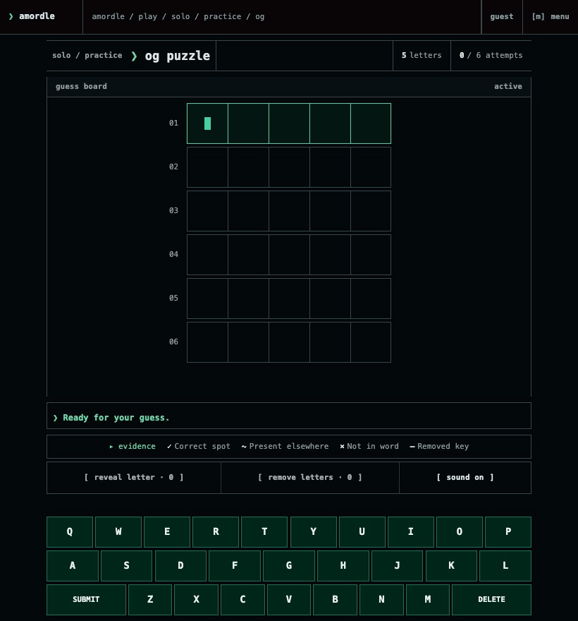

# Amordle

**Amordle = Wordle + Hurdle + Lichess − Ads.**

A free word game that combines [Wordle](https://en.wikipedia.org/wiki/Wordle) and [Hurdle](https://www.arkadium.com/games/hurdle/) and then upgrades both: any word length from 2 to 35 letters, three difficulties, a daily puzzle, and ranked multiplayer against other people with a real Elo rating attached.

No ads. No paywalls. Free, and it stays free.

**[Play it →](https://amordle.vercel.app)**



- [How to play](https://amordle.vercel.app/help)
- [How scoring works](https://amordle.vercel.app/methodology): the Elo equation, both K factors, the XP curve, and every coin price, read out of the code that runs
- [Changelog](https://ryanjosephkamp.github.io/amordle-updates/)
- [Why I built it](https://ryanjosephkamp.github.io/blog/articles/amordle/)

## The two modes

**OG** is Wordle, upgraded. One puzzle, one answer, one colored tile per guess letter.

**GO** is Hurdle, upgraded: a chain of five, seven, or ten puzzles where every answer you solve carries forward as evidence in the next one.

Both are playable solo, with no account, and both are playable against another person in **COMBAT**, which does need one: one shared board, alternating turns, and a rating that moves when you win or lose. Ratings live in forty separate pools (ten clocks × two modes × Hard Mode on or off), plus one for each of the two ranked Dailies, because a rating only means something when everyone holding it played the same game.

## Practice and Daily

**Practice** is where the customization lives: 2 to 35 letters, three nested difficulties, and optional Hard Mode. Play as much of it as you want.

**Daily** is one five-letter puzzle a day, the same word for everybody, in OG or as a five-puzzle GO chain. Finishing either one keeps your streak, even if you lose.

## Where the words come from

Every word is drawn from the [English OpenList](https://english-openlist.pages.dev/), a free list of over 345,000 English words, kept up by a nightly run that checks new candidates against dictionaries. It is published in full, so the vocabulary the game draws on can be inspected rather than taken on trust. It is also the reason the game can offer 2 to 35 letters at all.

The game ships a pinned copy of the list in `data/word-lists/`, so the vocabulary doesn’t change under a running deployment. A new revision goes in through a reviewed refresh (`pnpm word-data:refresh`), and the steps are in `docs/operations/WORD-AUTHORITY-RUNBOOK.md`.

## Running it locally

Requires pnpm 11.17.0. `pnpm install` fetches the exact Node version the scripts run on (24.18.0) into `.tooling/`, unless your system Node already matches. The Supabase-backed features (accounts, COMBAT, and ratings) need your own Supabase project; Solo play works without one.

```sh
pnpm install
cp .env.example .env.local   # then fill in your own Supabase values
pnpm dev
```

`.env.example` documents every variable. Nothing prefixed `NEXT_PUBLIC_` may hold a secret. A build guard in `next.config.ts` refuses to produce a deployment artifact without browser-safe Supabase configuration, and names the missing value.

## Checks

```sh
pnpm browser:install        # once, before the browser suites: Chromium, Firefox, and WebKit into .cache/playwright
pnpm check                  # format, lint, types, build, and the structural verifiers
pnpm test:domain            # pure domain tests, no browser
pnpm test:browser           # component and interaction tests
pnpm test:e2e:fixture       # end-to-end flows in Chromium, Firefox, and WebKit, against a mocked backend
pnpm test:visual            # responsive, contrast, and forced-colors sweeps
pnpm test:acceptance:local  # all of the above, in order
pnpm test:e2e:services      # the same flows against real services; needs the E2E_* values in .env.example
```

The verifiers under `pnpm check` are the unusual part. They assert things types cannot: that the migration set is append-only and its applied files unchanged, that server-only code never reaches the browser bundle, and that the bundle stays inside its size budgets. The domain tests check that the published scoring numbers still match the SQL that computes them.

## Layout

| Path | What it holds |
|---|---|
| `src/` | the application: `domain/` is pure rules, `features/` is UI, and `adapters/` talks to Supabase |
| `supabase/migrations/` | every migration, append-only and hash-verified |
| `data/` | the bundled word lists |
| `docs/` | architecture decisions, the word-data runbook, the keyboard guide, and the demo GIF |
| `public/` | the web app manifest and the service worker |
| `tests/` | domain, browser, fixture, service, and visual suites |
| `scripts/` | the verifiers, word-data tooling, and maintenance scripts |

## Contributing

Bug reports and feature requests are welcome as [issues](https://github.com/ryanjosephkamp/amordle/issues). For a security problem, please use the repository’s private vulnerability reporting (the Security tab) instead of a public issue. If you are opening a pull request, run `pnpm check` first; it catches most of what review would.

## License

[GNU AGPL-3.0](LICENSE).

Use it, change it, self-host it. The one condition is that if you run a modified version as a public service, you publish your source too. Amordle exists because word games got worse when they got monetized; the license is there so this one cannot quietly become the thing it was built against.

The bundled word lists come from the English OpenList and are under the MIT license.
